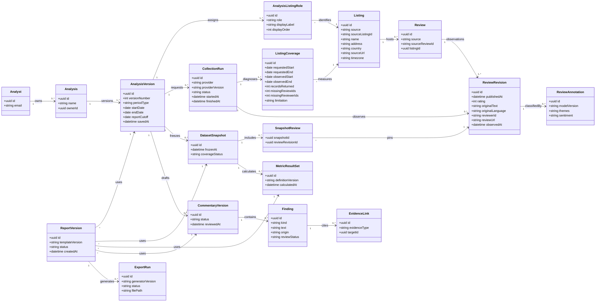

# Logical class diagram

Status: proposed domain model, not a final SQL schema. It separates source observations, immutable analysis snapshots, derived metrics, and report versions so an old export can be reproduced. The [source specification](../../Retail_Review_Analytics_Internal_Specification%20%281%29.docx) controls behavior if the implementation model changes.

## Invariants and modelling notes

- Each `AnalysisVersion` has exactly one `primary` role. It may have any number of `additionalOwn`, `competitor`, and `anchor` roles. Role constraints and duplicate listing handling require explicit database checks.
- `Listing` identity is source plus source listing ID. `Review` identity is source plus stable review ID, with a listing consistency check. Missing IDs require a validated source-specific fallback before ingestion.
- `ReviewRevision` preserves observed source changes. `DatasetSnapshot` explicitly pins revision IDs through `SnapshotReview` and records coverage, so newer observations cannot rewrite old calculations.
- `MetricResultSet` is deterministic and tied to a definition version. An evidence link resolves to a metric result or pinned review revision; a polymorphic link is shown conceptually and needs referentially safe implementation.
- `ReviewAnnotation` is derived, versioned, and may be absent. It does not replace original review text or star ratings.
- `ReportVersion` is immutable and binds configuration, dataset, metrics, commentary, and template. `ExportRun` records each attempted PPTX generation.
- Authorized access may later require an explicit `AnalysisAccess` class if accounts extend beyond single owners; access requirements must still be enforced now.
- Opaque reviewer IDs are scoped by source. Cross-source person matching by names, avatars, or language is outside the model.
